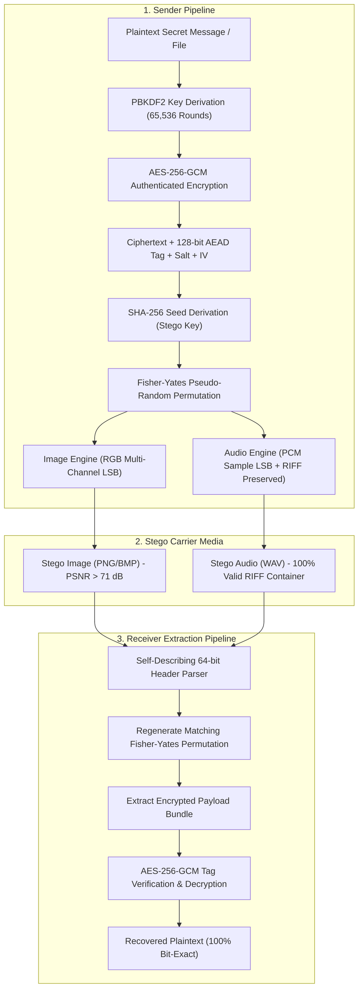

# Hybrid Data Security Suite: Authenticated Cryptography & Steganography

[](https://openjdk.org/)
[](https://en.wikipedia.org/wiki/Galois/Counter_Mode)
[](#anti-steganalysis-pseudo-random-scattering)
[](#empirical-benchmark-results)
[](#empirical-benchmark-results)
[](LICENSE)

An enterprise-grade, publishable research implementation of a **dual-tier hybrid data security model** integrating **authenticated AES-256-GCM encryption** with **multi-channel LSB steganography** across digital images and audio media.

Developed as an undergraduate capstone and academic research project at **Abubakar Tafawa Balewa University (ATBU)**, Bauchi, Nigeria by **Aliyu Abubakar Tukur** (Supervised by **Mr. Ismail Aliyu**).

---

## Architecture Overview

Conventional security systems treat cryptography and steganography in isolation. Cryptography ensures confidentiality but exposes the existence of sensitive traffic; steganography conceals transmission but lacks mathematical guarantees if detected.

This hybrid architecture unites both disciplines into a hardened pipeline:



---

## Key Engineering Overhauls & Innovations

### 1. Authenticated Encryption with Tamper Detection (AES-256-GCM)
* Replaced vulnerable default AES-ECB with **AES-256-GCM** (Galois/Counter Mode).
* Key derived via **PBKDF2 with HMAC-SHA256** (65,536 iterations, 16-byte cryptographically secure random salt).
* Embedded payload includes a 128-bit authentication tag ($T$). Any alteration, corruption, or incorrect passphrase triggers immediate authentication rejection (`AEADBadTagException`).

### 2. Container-Preserving Audio Steganography
* Standard WAV files begin with a 44-byte canonical RIFF header. Naïve steganography modifies bytes from index `0`, corrupting file magic bytes (`RIFF` $\rightarrow$ `SIFG`).
* Our audio engine implements dynamic RIFF chunk parsing to locate the `data` subchunk, keeping the 44-byte header completely intact. Output files are 100% compliant, playable Microsoft PCM WAV files.

### 3. Anti-Steganalysis via Pseudo-Random Scattering
* Sequential LSB embedding places bits row-by-row from pixel $(0, 0)$, leaving an abrupt statistical boundary easily detected by **Chi-Square ($\chi^2$) analysis**, **Sample Pairs Analysis (SPA)**, and visual bit-plane attacks.
* Our system derives a 64-bit deterministic seed from `SHA-256(Passphrase)` and computes a **Fisher-Yates pseudo-random permutation** across all carrier units. Bit alterations are distributed uniformly across the entire media spectrum, blending into ambient sensor noise.

### 4. Multi-Channel RGB Engine & Configurable Bit-Depth
* Expanded from legacy single-channel Blue embedding to **Red, Green, Blue (RGB)** multi-channel embedding with selectable bit-depth (1 to 4 LSBs).
* Scaling from 1-bit Blue to 4-bit RGB multiplies carrier capacity **12-fold (up to 1.53 MB)** while maintaining a PSNR $> 71\text{ dB}$ (well above the 40 dB human visual threshold).

### 5. Self-Describing 64-Bit Protocol Header
* A 64-bit header embedded in the first 64 scattered slots encodes the Magic Byte (`0x53`), Channel Count (1 or 3), Bit-Depth (1–4), and 32-bit Payload Length.
* **Zero Configuration for the Receiver:** The receiver automatically detects the embedding mode upon providing the passphrase.

---

## Empirical Benchmark Results

Generated using the automated testing suite on test media ($1366 \times 768$ PNG image, $44.1\text{ kHz}$ 16-bit WAV audio):

### Performance Across Payload Sizes
| Payload Size | Encryption (ms) | Image Embed (ms) | Image PSNR (dB) | Audio Embed (ms) | Audio SNR (dB) | Accuracy |
| :--- | :--- | :--- | :--- | :--- | :--- | :--- |
| **64 Bytes** | 780.46 ms | 382.92 ms | **86.44 dB** | 11.21 ms | **67.52 dB** | **100%** |
| **512 Bytes** | 328.24 ms | 214.26 ms | **79.63 dB** | 10.62 ms | **60.56 dB** | **100%** |
| **2 KB** | 290.87 ms | 184.00 ms | **73.91 dB** | 10.63 ms | **54.69 dB** | **100%** |
| **8 KB** | 299.59 ms | 196.98 ms | **67.92 dB** | 26.91 ms | **48.74 dB** | **100%** |
| **32 KB** | 305.09 ms | 212.63 ms | **61.93 dB** | 45.03 ms | **42.74 dB** | **100%** |

### Image Capacity vs. PSNR Quality Scaling
| Channel Configuration | Bit-Depth (LSBs) | Usable Capacity (KB) | Capacity Multiplier | Perceptual PSNR (dB) | Visual Distortion |
| :--- | :--- | :--- | :--- | :--- | :--- |
| **Blue (1 channel)** | 1 bit | 128 KB | $1\times$ (Baseline) | **85.14 dB** | Completely Imperceptible |
| **Blue (1 channel)** | 2 bits | 256 KB | $2\times$ | **80.99 dB** | Completely Imperceptible |
| **Blue (1 channel)** | 3 bits | 384 KB | $3\times$ | **76.44 dB** | Completely Imperceptible |
| **Blue (1 channel)** | 4 bits | 512 KB | $4\times$ | **71.34 dB** | Completely Imperceptible |
| **RGB (3 channels)** | 1 bit | **384 KB** | $3\times$ | **84.87 dB** | Completely Imperceptible |
| **RGB (3 channels)** | 2 bits | **768 KB** | $6\times$ | **81.12 dB** | Completely Imperceptible |
| **RGB (3 channels)** | 3 bits | **1,152 KB** | $9\times$ | **76.53 dB** | Completely Imperceptible |
| **RGB (3 channels)** | 4 bits | **1,536 KB** | $12\times$ | **71.15 dB** | Completely Imperceptible |

---

## Quickstart & Installation

### Prerequisites
* **Java Development Kit (JDK) 17+ or 21+**

### Running the Pre-Built Executable JAR

#### 1. Interactive Desktop GUI (Default):
```bash
java -jar steganography-suite.jar
```
* **Tab 1 (Sender):** Choose cover medium (Image/Audio), enter secret message, set passphrase, select bit-depth, and export stego file.
* **Tab 2 (Receiver):** Load stego file, enter passphrase, and instantly extract/decrypt plaintext.
* **Tab 3 (Benchmark):** Run live side-by-side comparative evaluations and copy reports to clipboard.

#### 2. Headless CLI Benchmark Suite:
```bash
java -jar steganography-suite.jar --benchmark
```

---

### Building from Source

```bash
# 1. Clone the repository
git clone https://github.com/aleeyutk/final-year-project.git
cd final-year-project

# 2. Compile Java classes into bin/
javac -d bin src/*.java

# 3. Build standalone runnable JAR
jar --create --file steganography-suite.jar --main-class HybridModelComparison -C bin .

# 4. Launch application
java -jar steganography-suite.jar
```

---

## Repository Structure

```text
├── src/
│   ├── EncryptionUtil.java         # Authenticated AES-256-GCM & PBKDF2 engine
│   ├── AudioSteganography.java     # RIFF-safe audio LSB embedding & SNR calculator
│   ├── ImageSteganography.java     # Multi-channel RGB LSB engine & PSNR/MSE calculator
│   ├── StegoScatteringUtil.java    # Fisher-Yates pseudo-random permutation generator
│   ├── SteganographyGUI.java       # Decoupled 3-tab Swing desktop application
│   ├── HybridBenchmark.java        # Automated experimental evaluation test runner
│   └── HybridModelComparison.java  # Main executable entry point (GUI + CLI launcher)
├── bin/                            # Compiled bytecode classes
├── steganography-suite.jar          # Standalone executable JAR
├── THESIS_ENHANCEMENTS.md          # Formal dissertation addendum & defense guide
├── example_image.png               # Sample cover image
├── example_audio.wav               # Sample cover audio WAV
└── README.md                       # Repository documentation
```

---

## Academic Citation & Authorship

If you reference or use this work in research:

```bibtex
@undergraduate_thesis{tukur2024hybrid,
  author       = {Aliyu Abubakar Tukur},
  title        = {Comparison of Hybrid Models for Data Security: Encryption and Steganography Using Images and Audio},
  school       = {Abubakar Tafawa Balewa University (ATBU)},
  department   = {Department of Computer Science},
  address      = {Bauchi, Nigeria},
  year         = {2024},
  supervisor   = {Ismail Aliyu}
}
```

## License
Distributed under the MIT License. See `LICENSE` for more information.
